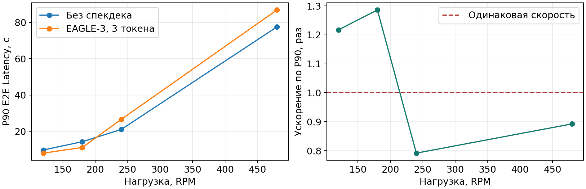
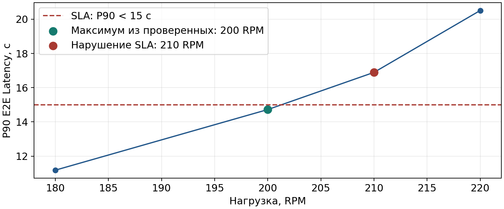

ДЗ 6. Ускорение инференса

Qwen3-8B на одной A100 80 GB (GPU 1). vLLM 0.22.0, AIPerf 0.13.0. Thinking выключен, temperature=0, seed=42, max_tokens=512. Данные не изменялись.

1. Ускорение при 120 RPM

Каждая конфигурация обработала все 640 запросов. Прогрев: 40 запросов. Prefix cache очищался до прогрева и после теста; при смене конфигурации сервер перезапускался. S = Mean бейзлайна / Mean конфигурации.

| Конфигурация | Изменения | Mean, с | P90, с | S |
| --- | --- | --- | --- | --- |
| baseline | Стандартные настройки | 6.90 | 9.76 | 1.00 |
| chunk1024 | 32 последовательности, бюджет 1024 токена | 6.96 | 9.86 | 0.99 |
| chunk2048 | 64 последовательности, бюджет 2048 токенов | 6.93 | 9.76 | 0.99 |
| eagle3 | 64 последовательности, бюджет 2048; EAGLE-3, 3 draft-токена | 4.89 | 8.02 | 1.41 |

Настройка лимитов и prefill не помогла. У бейзлайна TTFT всего 0,12 с, основное время занимает генерация. EAGLE-3 выдает несколько токенов за шаг и дал ускорение 1,41 раза. Это лучший результат среди четырех проверенных конфигураций.

2. Спекдекод и нагрузка

Сравниваются одинаковые настройки 64 seq / 2048 tokens, с EAGLE-3 и без него. При каждом RPM - те же 640 запросов. Справа: P90 без спекдека / P90 со спекдеком. Точка 120 RPM взята из первого этапа.

На 180 RPM спекдек быстрее: P90 11,13 против 14,31 с. Первое ухудшение на сетке - 240 RPM: 26,60 против 21,06 с. Граница находится между 180 и 240 RPM. Draft и проверка добавляют работу; при высокой нагрузке растет очередь. На 960 RPM у EAGLE-3 было 65 таймаутов: эта точка исключена из графиков, но сохранена в таблице.

3. Максимальная нагрузка

Конфигурация: eagle3. Каждый тест: 300 секунд подачи запросов через load_test.sh, затем ожидание ответов. Условие: P90 E2E < 15 секунд.

| RPM | Запросов | Mean, с | P90, с | Ошибок | SLA |
| --- | --- | --- | --- | --- | --- |
| 180 | 899 | 7.11 | 11.18 | 0 | да |
| 200 | 999 | 8.84 | 14.72 | 0 | да |
| 210 | 1049 | 10.56 | 16.89 | 0 | нет |
| 220 | 1099 | 12.59 | 20.51 | 0 | нет |

Максимум среди проверенных нагрузок: 200 RPM (3.33 RPS), P90 = 14.72 с.

При 210 RPM P90 уже 16,89 с, при 220 RPM - 20,51 с. Поэтому подтвержденный максимум на проверенной сетке - 200 RPM; граница SLA локализована с шагом 10 RPM. Проверялась конфигурация с лучшей средней задержкой при 120 RPM.

На каждую точку выполнен один прогон. У 200 RPM запас до SLA всего 0,28 с; 180 RPM дают больший запас. Результат относится к этому GPU и датасету. В 300-секундных тестах запросы повторяются по кругу, кеш внутри теста включен.

Все конфигурации - в configs/, исходные результаты AIPerf - в results/, полная таблица - metrics.csv. Графики строятся скриптом plot_results.py; команды экспериментов сохранены в README.md.
